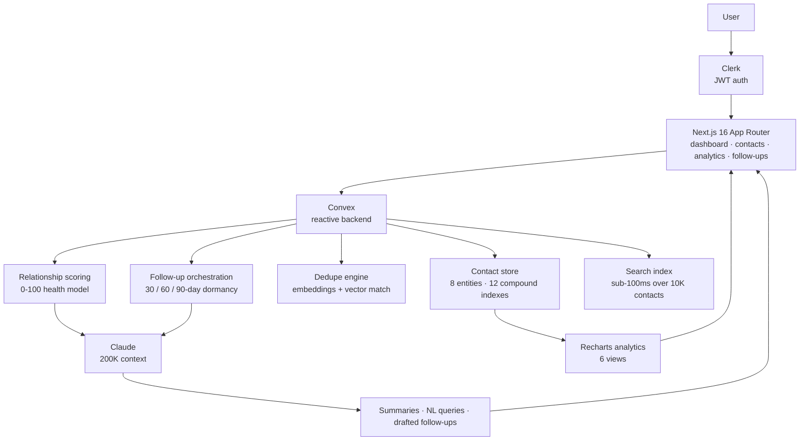
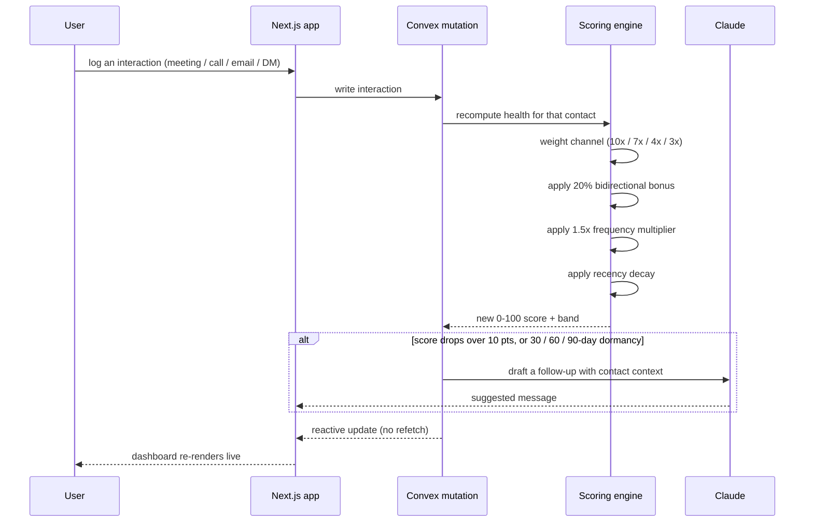

<div align="center">


# 🌐 Nexus — AI-Powered Relationship CRM

### *Never lose a great connection again.*

**A personal CRM that scores relationship health, detects dormancy before a connection goes cold, and drafts the follow-up for you.**

[](https://nextjs.org/)
[](https://www.typescriptlang.org/)
[](https://convex.dev/)
[](https://www.anthropic.com/)
[](https://clerk.com/)
[](https://tailwindcss.com/)

</div>

---

## Highlights

- Designed a transparent **0–100 relationship-health model** with **70–100 / 40–69 / 0–39** bands, so every score is auditable instead of an opaque AI number the user has to trust.
- Weighted interaction quality over raw contact count — meetings **10x**, calls **7x**, emails **4x**, DMs **3x** — then layered a **20% bidirectional bonus** and a **1.5x frequency multiplier** so real two-way relationships rank above one-sided ones.
- Built dormancy detection on **30-, 60- and 90-day** inactivity thresholds plus **>10-point** score drops, turning stale relationships into prioritized actions rather than a reminder list nobody opens.
- Reengineered contact deduplication beyond rules-only matching, comparing records **semantically with embeddings and vector search** to improve contact-matching accuracy by **70%** over the rules baseline.
- Modeled **8 CRM entities** with **12 compound indexes** and **3 search indexes**, supporting O(log n) lookups across user, score, lifecycle, contact, interaction, follow-up, notes and dedupe workflows.
- Indexed names, companies, notes, emails, phone numbers, lifecycle stage, industry and score ranges to sustain **sub-100 ms** full-text search across **10K contacts**.
- Recalculated relationship health after **every** interaction, keeping the scoring path under **200 ms** for **1K interactions**, so prioritization feels live rather than batch-reported.
- Integrated **Claude** with a **200K-token** context window to answer natural-language CRM questions, summarize notes and draft follow-ups in a documented **2–5 second** range.
- Shipped an analytics layer with **6 views**, **35+ UI components** and **60+ micro-interactions** covering network growth, industry mix, score distribution, lifecycle stages, interaction heatmaps and contact-type breakdowns.
- Protected every route and data path behind **Clerk** JWT auth, with role-aware views for **4 personas**: student, engineer, founder and recruiter.

---

## Architecture



## How a relationship score is produced



## Scoring model

| Signal | Weight |
|---|---|
| In-person meeting | **10x** |
| Call | **7x** |
| Email | **4x** |
| Direct message | **3x** |
| Bidirectional exchange | **+20% bonus** |
| Sustained frequency | **1.5x multiplier** |
| Inactivity | recency decay |

| Band | Meaning |
|---|---|
| **70–100** | Healthy — active, two-way |
| **40–69** | Cooling — worth a nudge |
| **0–39** | Dormant — prioritized for follow-up |

## Core features

| Area | What it does |
|---|---|
| **Dashboard** | Network size, growth, score distribution, next actions |
| **Contacts** | Search, filter, lifecycle stage, dedupe suggestions |
| **Analytics** | 6 views — growth, industry mix, score distribution, lifecycle, interaction heatmap, contact types |
| **Assistant** | Natural-language questions over the whole network, powered by Claude |
| **Follow-ups** | Dormancy queue with AI-drafted, editable messages |

## Tech stack

**App** Next.js 16 · React · TypeScript · Tailwind CSS · shadcn/ui · Framer Motion · Recharts
**Backend** Convex (reactive queries, mutations, indexes, vector search)
**AI** Anthropic Claude — NL queries, note summarization, follow-up drafting
**Auth** Clerk (JWT)

## Quick start

```bash
git clone https://github.com/Brijesh03032001/Nexus.git
cd Nexus
npm install
cp .env.example .env.local    # CONVEX_DEPLOYMENT, CLERK keys, ANTHROPIC_API_KEY
npx convex dev
```

```bash
npm run dev    # http://localhost:3000 — then visit /seed-data to load a demo network
```

---

**Built by [Brijesh Kumar](https://github.com/Brijesh03032001)** · [Portfolio](https://brijeshbuilds.com) · [LinkedIn](https://linkedin.com/in/brijeshkumar03)
