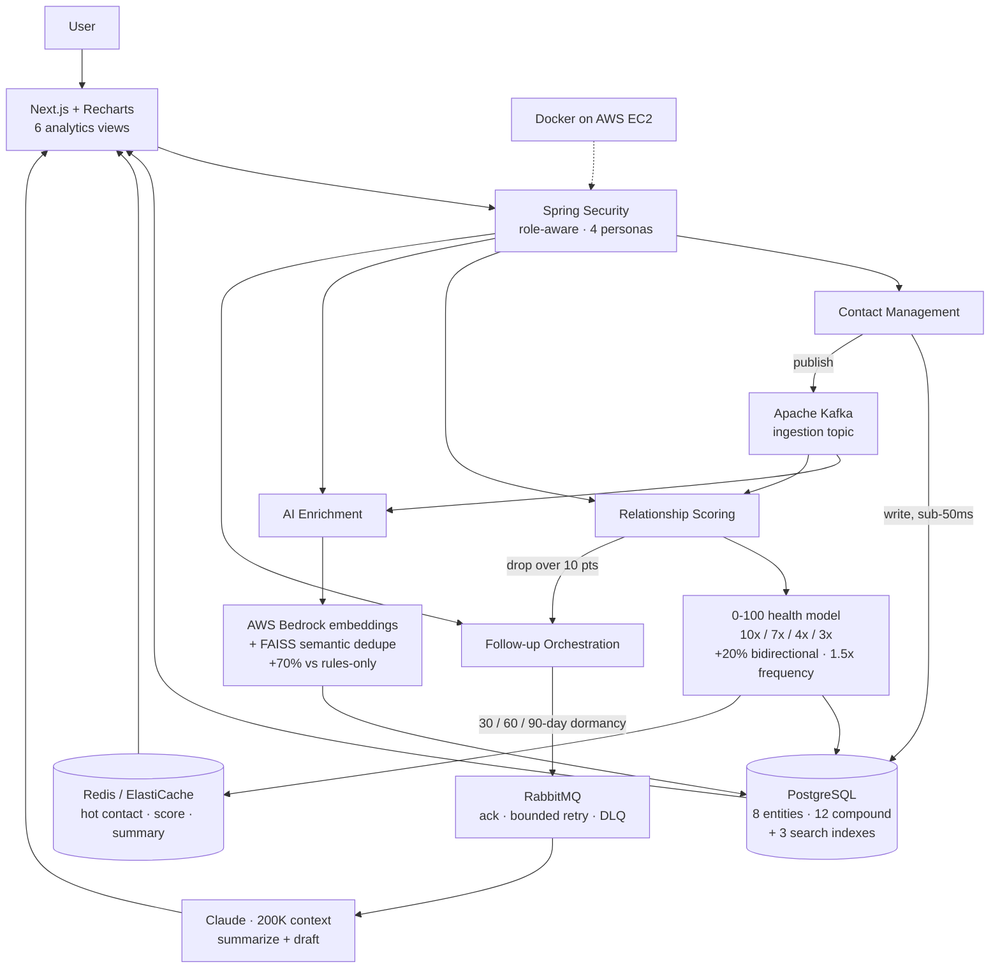
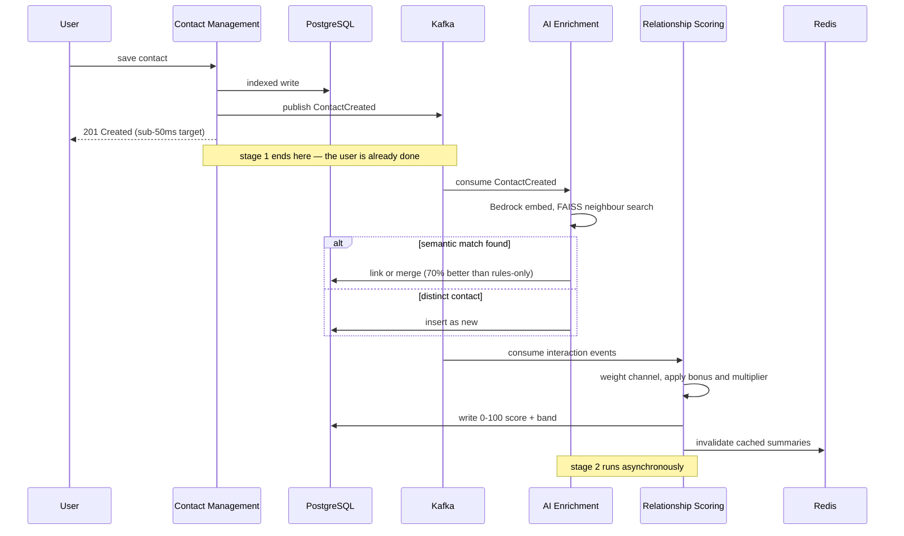
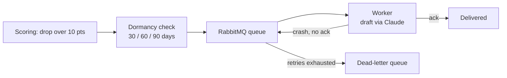

<div align="center">


# 🌐 Nexus — AI-Powered Relationship CRM

### *Event-driven relationship intelligence on Spring Boot, Kafka and vector search*

**Never lose a great connection again.** Contact writes stay fast because AI enrichment never sits on the save path — Kafka carries it away, four Spring Boot services own their own slice, and a transparent 0-100 health model says who to call next.

[](https://openjdk.org/)
[](https://spring.io/projects/spring-boot)
[](https://kafka.apache.org/)
[](https://rabbitmq.com/)
[](https://redis.io/)
[](https://postgresql.org/)
[](https://aws.amazon.com/bedrock/)
[](https://nextjs.org/)

</div>

---

## Highlights

- **Decoupled contact saves from AI enrichment** by splitting the CRM into **4 Spring Boot services** — contact management, relationship scoring, AI enrichment and follow-up orchestration — and routing ingestion through **Kafka**, moving model processing off the save path instead of hiding business logic in the UI.
- Replaced synchronous REST chaining with Kafka ingestion across **2 asynchronous stages**, preserving a documented **sub-50 ms** write target for indexed mutations.
- **Reengineered contact deduplication** past the limits of rules-only matching, combining **AWS Bedrock embeddings** with **FAISS** vector search to compare records semantically and improve contact-matching accuracy by **70%** over the baseline.
- Added **Redis caching** (Amazon ElastiCache) for hot contact, score and network-summary reads, keeping relationship analysis under **3 seconds** on large graphs that would otherwise be re-walked on every dashboard load.
- Designed a transparent **0-100 relationship-health model** with **70-100 / 40-69 / 0-39** bands, weighting meetings **10x**, calls **7x**, emails **4x** and DMs **3x**, plus a **20% bidirectional bonus** and **1.5x frequency multiplier** — auditable, not an opaque AI number.
- Built dormancy detection on **30-, 60- and 90-day** inactivity thresholds plus score drops **over 10 points**, converting stale relationships into prioritized actions rather than reminders nobody opens.
- Added **RabbitMQ-backed workers** for queued follow-up notifications alongside Kafka ingestion, with explicit acknowledgments, bounded retries and dead-letter handling, so a job that crashes mid-send is retried independently of the request path.
- Protected the Spring Boot REST APIs with **Spring Security** and role-aware authorization for **4 personas** — student, engineer, founder, recruiter — enforced in the backend, not the client.
- Modeled **8 CRM entities** with **12 compound indexes** and **3 search indexes** for O(log n) lookups, sustaining **sub-100 ms** full-text search across **10K contacts** over names, companies, notes, emails, phone numbers, lifecycle stage, industry and score ranges.
- Recalculated relationship health after **every interaction**, holding the scoring path under **200 ms** for **1K interactions**, so prioritization is operational rather than batch-report driven.
- Integrated **Claude** with a **200K-token** context window for natural-language CRM queries, note summarization and follow-up drafting in a documented **2-5 second** range.
- Built the analytics layer in **Next.js and Recharts** with **6 views**, **35+ UI components** and **60+ micro-interactions** covering network growth, industry mix, score distribution, lifecycle stages, interaction heatmaps and contact-type breakdowns.
- Containerized the service boundaries with **Docker** for **AWS EC2**, externalizing Kafka, Redis, FAISS and AWS Bedrock as **4 runtime dependencies** instead of baking environment assumptions into code, with **Playwright** end-to-end tests for signup, contact creation, search and follow-up wired into CI.

---

## Architecture



## Saving a contact — the write path never waits on AI



## Follow-ups survive a worker crash



---

## Services

| Service | Owns | Talks to |
|---|---|---|
| **Contact Management** | Contact CRUD, indexed writes, full-text search | PostgreSQL, Kafka (producer) |
| **Relationship Scoring** | 0-100 health model, recency decay, band assignment | Kafka (consumer), PostgreSQL, Redis |
| **AI Enrichment** | Embedding, semantic dedupe, record linkage | Kafka (consumer), AWS Bedrock, FAISS |
| **Follow-up Orchestration** | Dormancy detection, queueing, drafted messages | RabbitMQ, Claude, PostgreSQL |

## Scoring and performance

| Signal | Weight |
|---|---|
| In-person meeting | **10x** |
| Call | **7x** |
| Email | **4x** |
| Direct message | **3x** |
| Bidirectional exchange | **+20% bonus** |
| Sustained frequency | **1.5x multiplier** |

| Band | Meaning |
|---|---|
| **70-100** | Healthy — active, two-way |
| **40-69** | Cooling — worth a nudge |
| **0-39** | Dormant — prioritized for follow-up |

| Path | Target |
|---|---|
| Indexed contact write | **sub-50 ms** |
| Full-text search across 10K contacts | **sub-100 ms** |
| Scoring recalculation, 1K interactions | **under 200 ms** |
| Relationship analysis, large graph (Redis-cached) | **under 3 s** |
| Claude natural-language query | **2-5 s** |

## Tech stack

**Services** Java · Spring Boot · Spring Web · Spring Security · Spring Data JPA · REST APIs
**Messaging** Apache Kafka (ingestion) · RabbitMQ (workers, ack + bounded retry + DLQ)
**Data** PostgreSQL · Redis / Amazon ElastiCache
**AI** AWS Bedrock embeddings · FAISS vector search · Anthropic Claude (200K context)
**Web** Next.js · React · TypeScript · Tailwind CSS · Recharts · Framer Motion · Clerk
**Delivery** Docker · AWS EC2 · Playwright end-to-end tests in CI

## Quick start

```bash
docker compose up -d        # PostgreSQL, Kafka, RabbitMQ, Redis
```

```bash
./mvnw spring-boot:run      # run from each service module
```

```bash
npm install && npm run dev  # http://localhost:3000
```

```bash
npx playwright test         # signup, contact creation, search, follow-up
```

Externalized runtime dependencies: `KAFKA_BOOTSTRAP_SERVERS`, `RABBITMQ_URL`, `REDIS_URL`, `AWS_REGION` with Bedrock access, `ANTHROPIC_API_KEY`.

---

**Built by [Brijesh Kumar](https://github.com/Brijesh03032001)** · [Portfolio](https://brijeshbuilds.com) · [LinkedIn](https://linkedin.com/in/brijeshkumar03)
